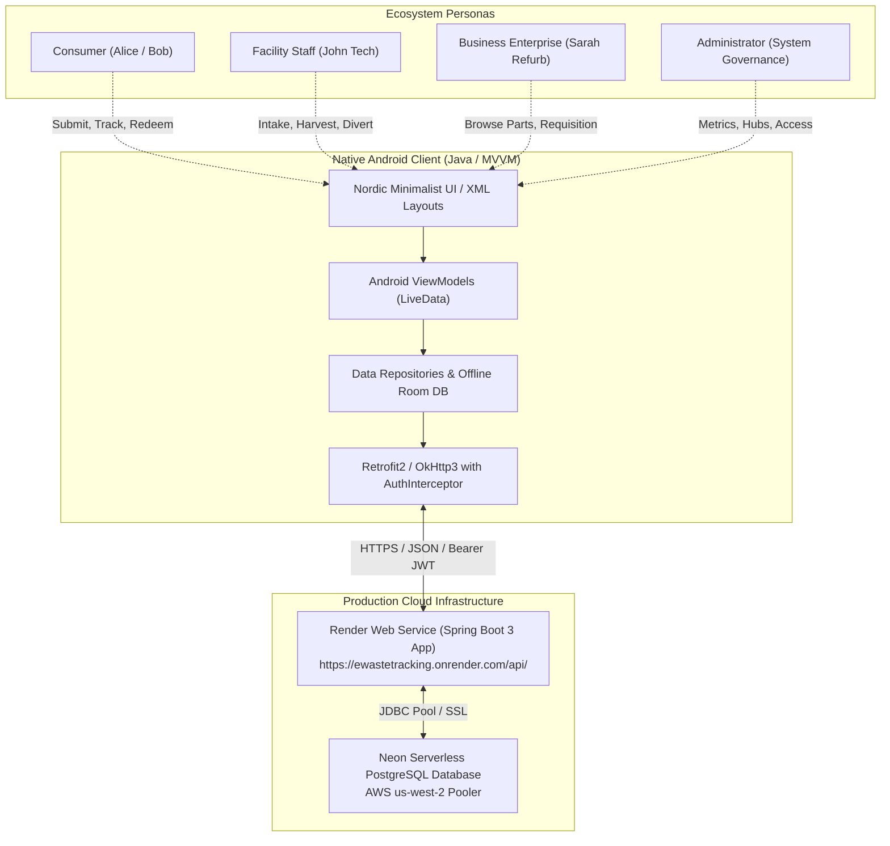
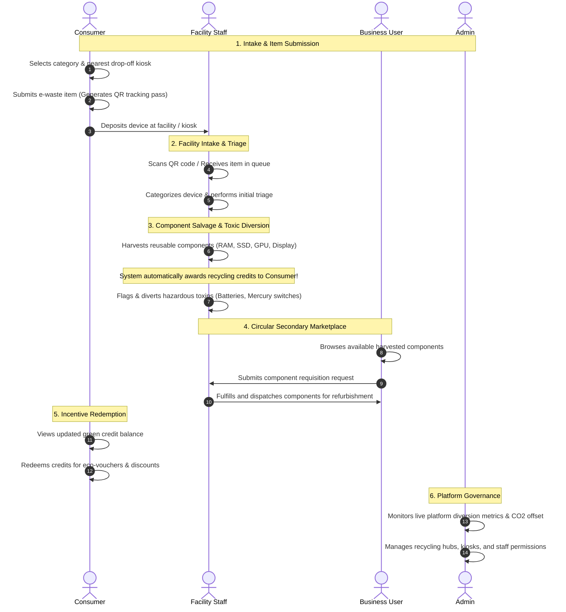
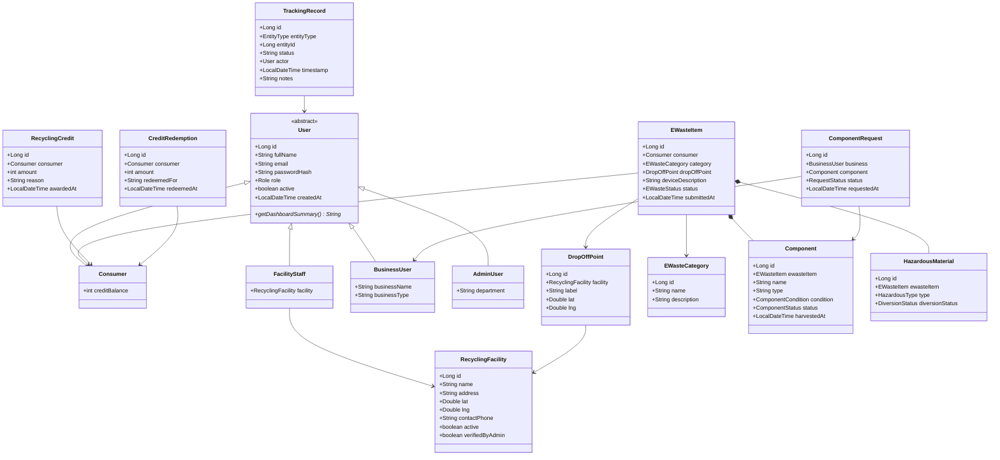

# EcoTrack: E-Waste Recycling & Circular Component Tracking Platform

[](https://spring.io/projects/spring-boot)
[](https://www.oracle.com/java/)
[](https://developer.android.com/)
[](https://neon.tech/)
[](https://render.com/)
[](LICENSE)

A full-stack, enterprise-grade circular economy platform engineered to tackle global electronic waste. **EcoTrack** unites household consumers, recycling centers, refurbishment enterprises, and regulatory administrators into an auditable, closed-loop tracking ecosystem. It tracks discarded electronics, salvages reusable components for secondary marketplaces, diverts toxic chemicals from landfills, and incentivizes sustainable habits through gamified recycling credits.

---

## Table of Contents
1. [Executive Summary & Problem Statement](#executive-summary--problem-statement)
2. [Platform Architecture & System Topology](#platform-architecture--system-topology)
3. [Technology Stack](#technology-stack)
4. [Nordic Architectural Minimalist Design System](#nordic-architectural-minimalist-design-system)
5. [End-to-End Circular Lifecycle & User Personas](#end-to-end-circular-lifecycle--user-personas)
   - [Consumer (Household Donor)](#1-consumer-household-donor)
   - [Facility Staff (Recycling & Salvage Operator)](#2-facility-staff-recycling--salvage-operator)
   - [Business User (Refurbisher & Enterprise Reclaimer)](#3-business-user-refurbisher--enterprise-reclaimer)
   - [System Administrator (Governance & Compliance)](#4-system-administrator-governance--compliance)
6. [Cloud Infrastructure & Production Deployments](#cloud-infrastructure--production-deployments)
7. [Software Engineering, OOP Principles & Design Patterns](#software-engineering-oop-principles--design-patterns)
8. [Database Schema & Entity Relationship Diagram](#database-schema--entity-relationship-diagram)
9. [Complete REST API Specification](#complete-rest-api-specification)
10. [Native Android Client Architecture (MVVM)](#native-android-client-architecture-mvvm)
11. [Setup, Installation & Execution Guide](#setup-installation--execution-guide)
12. [Testing & Verification](#testing--verification)

---

## Executive Summary & Problem Statement

Electronic waste (e-waste) is the fastest-growing municipal waste stream globally, generating over 50 million metric tons annually. Discarded computers, smartphones, and batteries pose severe environmental hazards due to toxic heavy metals (lead, cadmium, mercury, lithium) while simultaneously wasting high-grade salvageable components (RAM, storage drives, displays, microcontrollers).

**EcoTrack** solves this crisis through a transparent, full-lifecycle digital platform:
- **Consumer Empowerment**: Convenient drop-off kiosk location, transparent item tracking, and immediate credit rewards.
- **Auditable Triage & Disassembly**: Strict facility workflows ensuring components are safely harvested and toxins are diverted to certified hazardous facilities.
- **Secondary Market Circularity**: Refurbishment enterprises can acquire verified components directly from recycling centers.
- **Regulatory Governance**: Platform oversight of facility certifications, public drop-off networks, and staff accountability.

---

## Platform Architecture & System Topology



---

## Technology Stack

### Backend
- **Core Language**: Java 17 LTS
- **Framework**: Spring Boot 3.3.4 (Web, Security, Data JPA, Validation)
- **Security**: Spring Security 6.x + JJWT (Java JWT `0.12.6`) stateless Bearer token authentication
- **Database / ORM**: Hibernate 6.x / Spring Data JPA
- **Database Engines**:
  - **Production**: Neon Serverless PostgreSQL (`ep-floral-art-artdqtli-pooler.c-4.us-west-2.aws.neon.tech / neondb`)
  - **Local / Test**: In-memory H2 Database (`jdbc:h2:mem:ewastedb`)
- **API Documentation**: SpringDoc OpenAPI 3.0 / Swagger UI (`/swagger-ui.html`)
- **Build & CI**: Apache Maven 3.8+

### Native Android Mobile Client
- **Core Language**: Java (minSdk 26, targetSdk 34)
- **Architecture**: MVVM (Model-View-ViewModel) + Repository Pattern
- **Networking**: Square Retrofit 2.9.0 + OkHttp 4.12.0 with custom `AuthInterceptor` (automatic JWT Bearer header injection)
- **Local Persistence & Caching**: AndroidX Room Database 2.6.1 + SharedPreferences (`SessionManager`)
- **UI & Design**: Google Material Design 3 (`com.google.android.material`), Custom Vector Drawables, ConstraintLayout
- **QR / Barcode Processing**: ZXing Core 3.5.3 (`QrCodeHelper`) for dynamic QR pass generation
- **Theming**: Dynamic Dark / Light mode switching persisted via `AppCompatDelegate`

---

## Nordic Architectural Minimalist Design System

The application strictly implements the **Nordic Architectural Minimalist** design philosophy, balancing spacious elegance, high functional contrast, and tactile feedback:

- **Curated Color Palette**:
  - `primary_green`: `#1B3B2B` (Deep pine forest)
  - `primary_green_light`: `#E8F0EC` (Soft organic sage tint)
  - `accent_green`: `#2D6A4F` (Lush Scandinavian woodland)
  - `background_light`: `#F8F9F8` (Warm off-white architectural canvas)
  - `background_dark`: `#121614` (Deep matte charcoal)
  - `card_light`: `#FFFFFF` & `card_dark`: `#1A201C`
  - `card_stroke`: `#E2E8E4` (Crisp 1dp structural hairline)
- **Signature Elements**:
  - **Inverted Triangle Action Button (▼)**: An unconventional floating action trigger anchored at the top right of all screens, opening the unified system quick actions, profile badge, theme selector, and session controls.
  - **Floating Island Dock Navigation**: Pill-shaped bottom navigation bar elevated above the canvas with active icon pill badges.
  - **1-Tap Demo Account Carousel**: Horizontally scrollable role cards (`Alice Green`, `John Tech`, `Sarah Refurb`, `System Admin`) with instant credential population and active green stroke highlights.

---

## End-to-End Circular Lifecycle & User Personas



### 1. Consumer (Household Donor)
- **Drop-Off Locator**: Browse verified recycling facilities and automated public collection kiosks with coordinates, operating hours, and accepted device categories.
- **Item Submission & Digital Pass**: Register discarded electronics (Laptops, Smartphones, Tablets, Appliances) and generate an instant scannable QR verification pass.
- **Audit Timeline**: Track items through real-time state changes (`SUBMITTED` → `RECEIVED` → `CATEGORIZED` → `HARVESTED` → `DIVERTED` → `COMPLETED`).
- **Recycling Credits & Rewards**: Earn automated green credits when components are salvaged or hazardous materials are safely diverted. Redeem credits for gift cards and eco-friendly vouchers.

### 2. Facility Staff (Recycling & Salvage Operator)
- **Intake Queue & Fast Check-In**: View pending drop-offs, verify donor devices, check items into the facility registry, and update tracking records.
- **Device Triage & Categorization**: Record technical triage inspection notes and categorize device condition.
- **Component Harvesting**: Dismantle hardware and catalog salvaged working parts (`RAM`, `Storage`, `Motherboards`, `Screens`, `Power Units`). Automatically prevents duplicate registrations and triggers immediate consumer credit awards.
- **Hazardous Material Diversion**: Identify toxic sub-assemblies (`Lithium-Ion Batteries`, `Lead-acid`, `Mercury bulbs`) and log their certified diversion from municipal landfills.
- **Requisition Fulfillment**: Review, approve, and fulfill component orders placed by verified refurbishers.

### 3. Business User (Refurbisher & Enterprise Reclaimer)
- **Salvaged Parts Marketplace**: Live catalog of harvested components with real-time condition grading (`NEW`, `EXCELLENT`, `GOOD`, `FAIR`) and hardware category filters.
- **One-Tap Requisition**: Claim working parts directly from recycling centers with automated requisition status workflows (`PENDING` → `APPROVED` → `FULFILLED` → `CANCELLED`).
- **Procurement Tracking**: Monitor order histories, delivery stages, and facility dispatch confirmations.

### 4. System Administrator (Governance & Compliance)
- **Executive Impact Pulse**: Real-time KPI dashboard tracking total kg of e-waste diverted, estimated metric tons of CO₂ emissions prevented, components reclaimed, and active network footprint.
- **Dual-Pathway Facility Onboarding**: Direct provisioning of authorized recycling centers or auditing and approving pending facility sign-in applications.
- **Kiosk & Drop-Off Network CRUD**: Deploy, edit, and link consumer-facing collection boxes and automated lockers to parent processing facilities.
- **Staff Access Controls & Reassignments**: Manage operational permissions, toggle operator accounts (`ACTIVE` / `SUSPENDED`), and reassign staff members between operating centers.

---

## Cloud Infrastructure & Production Deployments

The platform is deployed entirely in the cloud with zero reliance on local emulators or proxy tunnels:

| Component | Provider / Platform | Host / Details |
| :--- | :--- | :--- |
| **REST API Backend** | **Render** | `https://ewastetracking.onrender.com/api/` |
| **Relational Database** | **Neon Serverless PostgreSQL** | `ep-floral-art-artdqtli-pooler.c-4.us-west-2.aws.neon.tech` / `neondb` |
| **Source Control & CI** | **GitHub** | `https://github.com/ahmedalivp/ewastetracking.git` (`main` branch) |
| **Android Client** | **Physical Device / APK** | Preconfigured with live cloud `BASE_URL` |

### Cloud Schema Migrations
The production Neon database maintains schema parity with the latest platform features:
```sql
ALTER TABLE users ADD COLUMN IF NOT EXISTS active BOOLEAN NOT NULL DEFAULT true;
ALTER TABLE recycling_facilities ADD COLUMN IF NOT EXISTS active BOOLEAN NOT NULL DEFAULT true;
ALTER TABLE recycling_facilities ADD COLUMN IF NOT EXISTS contact_phone VARCHAR(50);
```

---

## Software Engineering, OOP Principles & Design Patterns

The architecture demonstrates textbook-correct object-oriented design and enterprise architectural patterns:

| Pattern / Principle | Class / Interface | Architectural Role & Implementation Details |
| :--- | :--- | :--- |
| **Encapsulation** | All entities in `entity/` | Strict `private` field visibility with validated accessors and state mutation methods. Prevents unauthorized state alteration. |
| **Inheritance** | `User` (Abstract Base), `Consumer`, `FacilityStaff`, `BusinessUser`, `AdminUser` | JPA `JOINED` inheritance strategy. Base table `users` contains universal authentication and audit columns; child tables contain specialized attributes. |
| **Polymorphism** | `User.getDashboardSummary()` | Abstract method on `User` dynamically implemented across all 4 subclasses to provide role-specific dashboard overviews at runtime. |
| **Abstraction** | `TrackingService`, `CreditService`, `AdminService`, `FacilityService`, etc. | Interface-driven service design. High-level callers interact strictly with public interface contracts decoupled from concrete Spring `@Service` implementations. |
| **Composition** | `EWasteItem` | Modeled as a structural composite containing `EWasteCategory`, `DropOffPoint`, `List<Component>`, and `List<HazardousMaterial>`. |
| **Strategy Pattern** | `CreditStrategy`, `StandardCreditStrategy`, `HazardousBonusCreditStrategy` | Encapsulates credit computation algorithms. `CreditServiceImpl` dynamically selects strategies based on toxic material diversion and component value. |
| **GoF Builder Pattern** | `EWasteItemBuilder` | Fluent, hand-crafted Builder pattern enforcing invariant checks, valid category assignment, and default tracking statuses before persistence. |
| **Repository Pattern** | `repository/*Repository` | Spring Data JPA abstractions managing relational persistence, query generation, and transactional boundaries. |
| **MVVM Pattern** | `android-app` (`ui/*ViewModel`) | Android Architecture Components. Complete separation of UI views (`Activity`/`Fragment`) from business logic and data states using `LiveData` and reactive wrappers (`Resource<T>`). |

---

## Database Schema & Entity Relationship Diagram



---

## Complete REST API Specification

### 1. Authentication & Identity (`/api/auth`)
| Method | Endpoint | Access | Description |
| :--- | :--- | :--- | :--- |
| `POST` | `/api/auth/register` | Public | Register a new user (`CONSUMER`, `FACILITY_STAFF`, `BUSINESS`, `ADMIN`). |
| `POST` | `/api/auth/login` | Public | Authenticate with email/password; returns JWT token and dashboard summary. |
| `GET` | `/api/auth/profile` | Authenticated | Retrieve authenticated user profile with role-specific attributes. |

### 2. Public Platform Discovery (`/api`)
| Method | Endpoint | Access | Description |
| :--- | :--- | :--- | :--- |
| `GET` | `/api/categories` | Public | List all supported e-waste categories (Laptops, Phones, Batteries, etc.). |
| `GET` | `/api/drop-off-points` | Public | List all public kiosks and smart drop-off boxes with parent facility data. |
| `GET` | `/api/impact` | Public | Aggregate platform environmental impact (total kg diverted, CO₂ saved). |

### 3. Consumer Operations (`/api/consumer`)
| Method | Endpoint | Access | Description |
| :--- | :--- | :--- | :--- |
| `POST` | `/api/consumer/ewaste-items` | `ROLE_CONSUMER` | Register a new e-waste item for drop-off. |
| `GET` | `/api/consumer/ewaste-items` | `ROLE_CONSUMER` | List all historical submissions for the authenticated consumer. |
| `GET` | `/api/consumer/ewaste-items/{id}/tracking` | `ROLE_CONSUMER` | Retrieve immutable audit timeline for an item. |
| `GET` | `/api/consumer/credits` | `ROLE_CONSUMER` | Retrieve recycling credit history and rewards awarded. |
| `POST` | `/api/consumer/credits/redeem` | `ROLE_CONSUMER` | Redeem green credits for vouchers and merchant discounts. |

### 4. Facility Operations & Salvage (`/api/facility`)
| Method | Endpoint | Access | Description |
| :--- | :--- | :--- | :--- |
| `GET` | `/api/facility/ewaste-items` | `ROLE_FACILITY_STAFF` | Retrieve incoming intake queue filtered by status (`SUBMITTED`, etc.). |
| `PUT` | `/api/facility/ewaste-items/{id}/receive` | `ROLE_FACILITY_STAFF` | Confirm physical receipt of e-waste device at facility. |
| `PUT` | `/api/facility/ewaste-items/{id}/categorize`| `ROLE_FACILITY_STAFF` | Complete device triage and log inspection notes. |
| `POST` | `/api/facility/ewaste-items/{id}/components`| `ROLE_FACILITY_STAFF` | Harvest reusable component (auto-awards consumer credits). |
| `POST` | `/api/facility/ewaste-items/{id}/hazardous-materials` | `ROLE_FACILITY_STAFF` | Flag hazardous toxic substance inside device. |
| `PUT` | `/api/facility/hazardous-materials/{id}/divert` | `ROLE_FACILITY_STAFF` | Log verified diversion to certified hazardous facility. |
| `GET` | `/api/facility/components` | `ROLE_FACILITY_STAFF` | List harvested components residing in facility inventory. |
| `GET` | `/api/facility/component-requests` | `ROLE_FACILITY_STAFF` | List component requisition requests from business enterprises. |
| `PUT` | `/api/facility/component-requests/{id}/status` | `ROLE_FACILITY_STAFF` | Update order status (`FULFILLED`, `CANCELLED`). |

### 5. Business Circular Marketplace (`/api/business`)
| Method | Endpoint | Access | Description |
| :--- | :--- | :--- | :--- |
| `GET` | `/api/business/components` | `ROLE_BUSINESS` | Search and filter harvested parts available for secondary reuse. |
| `POST` | `/api/business/component-requests` | `ROLE_BUSINESS` | Place a requisition request for a harvested component. |
| `GET` | `/api/business/component-requests` | `ROLE_BUSINESS` | Retrieve business requisition orders and fulfillment status. |

### 6. Administrative Governance & Compliance (`/api/admin`)
| Method | Endpoint | Access | Description |
| :--- | :--- | :--- | :--- |
| `GET` | `/api/admin/metrics` | `ROLE_ADMIN` | Executive metrics (diversion kg, CO₂, pending center reviews). |
| `GET` | `/api/admin/facilities` | `ROLE_ADMIN` | List recycling centers with search and status filters. |
| `POST` | `/api/admin/facilities` | `ROLE_ADMIN` | Directly provision and onboard a new recycling facility. |
| `PUT` | `/api/admin/facilities/{id}` | `ROLE_ADMIN` | Update facility address, coordinates, and contact details. |
| `PUT` | `/api/admin/facilities/{id}/verify` | `ROLE_ADMIN` | Grant or revoke official circular certification. |
| `DELETE`| `/api/admin/facilities/{id}` | `ROLE_ADMIN` | Deactivate/remove facility from operating registry. |
| `POST` | `/api/admin/drop-off-points` | `ROLE_ADMIN` | Deploy a new public drop-off kiosk or smart box. |
| `PUT` | `/api/admin/drop-off-points/{id}` | `ROLE_ADMIN` | Edit kiosk location and parent facility binding. |
| `DELETE`| `/api/admin/drop-off-points/{id}` | `ROLE_ADMIN` | Decommission a public collection point. |
| `GET` | `/api/admin/staff` | `ROLE_ADMIN` | List all facility operators and current center assignments. |
| `PUT` | `/api/admin/staff/{id}` | `ROLE_ADMIN` | Toggle staff active credentials or reassign center. |

---

## Native Android Client Architecture (MVVM)

The mobile client is structured cleanly into modular layers following Google's recommended Android architecture:

```
android-app/app/src/main/java/com/ewaste/app/
├── EWasteApplication.java          # Global application state & theme initializer
├── data/
│   ├── api/                        # ApiClient, ApiService, AuthInterceptor (JWT Injection)
│   ├── local/                      # SessionManager (Preferences), Room AppDatabase
│   ├── model/                      # Java DTOs matching Spring Boot JSON models
│   └── repository/                 # AuthRepository, ConsumerRepository, FacilityRepository, etc.
├── ui/
│   ├── auth/                       # LoginActivity (Horizontal Demo Cards), RegisterActivity
│   ├── consumer/                   # ConsumerMainActivity, DropOff, Submissions, Credits
│   ├── facility/                   # FacilityMainActivity, IntakeQueue, Harvesting, Requisitions
│   ├── business/                   # BusinessMainActivity, Marketplace, Requisitions
│   ├── admin/                      # AdminMainActivity, Centers, Kiosks, Staff, BottomSheets
│   ├── adapter/                    # RecyclerView Adapters with DiffUtil & ViewHolder patterns
│   └── common/                     # Resource<T>, QuickActionMenuSheet (▼ Inverted Triangle)
└── util/                           # QrCodeHelper (ZXing generation), MapHelper
```

---

## Setup, Installation & Execution Guide

### Demonstration Pre-Seeded Accounts
The platform includes pre-seeded demonstration credentials across all roles:

| Persona | Email | Password | Role & Scope |
| :--- | :--- | :--- | :--- |
| **Consumer** | `alice@example.com` | `pass123` | Household donor with initial 100 green points. |
| **Facility Staff** | `staff@greentech.org` | `staff123` | Senior operator at GreenTech Recycling Center. |
| **Business User** | `contact@circularelectronics.com` | `biz123` | Circular Electronics Inc. (Refurbisher). |
| **System Admin** | `admin@ewaste.org` | `admin123` | Platform Executive Governance & Compliance. |

### 1. Running the Spring Boot Backend Locally
```bash
# Clone the repository
git clone https://github.com/ahmedalivp/ewastetracking.git
cd ewastetracking

# Build and run with Spring Boot (defaults to port 8080 and H2 in-memory DB)
mvn spring-boot:run
```
- **Swagger Documentation**: [http://localhost:8080/swagger-ui.html](http://localhost:8080/swagger-ui.html)
- **H2 Database Console**: [http://localhost:8080/h2-console](http://localhost:8080/h2-console) (JDBC URL: `jdbc:h2:mem:ewastedb`, User: `sa`, Password: *(empty)*)

### 2. Building & Installing the Android Mobile Client
```bash
cd android-app

# Run unit tests
./gradlew testDebugUnitTest

# Assemble debug APK
./gradlew assembleDebug

# Install directly on a connected physical device or running emulator
./gradlew installDebug
```

---

## Testing & Verification

The platform maintains comprehensive verification across both unit and system levels:

- **Backend Unit & Integration Tests**:
  - `mvn test`: 21 / 21 tests passing across `AuthControllerTest`, `ConsumerControllerTest`, `FacilityControllerTest`, and `CreditStrategyTest`.
- **Live Cloud Health Check**:
  ```bash
  curl -X GET https://ewastetracking.onrender.com/api/impact
  ```
  Returns live diversion metrics from the Neon PostgreSQL cloud database.
- **Physical Device Validation**:
  - Validated on **NIC-LX2** (Android 15) with responsive rendering across light and dark architectural themes, horizontal swipe carousels, and live network communication over HTTPS.

---

## License
Distributed under the MIT License. See `LICENSE` for more information.
